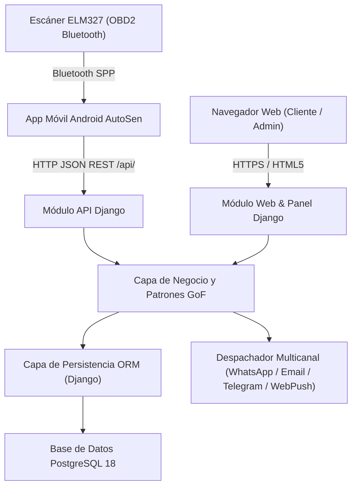
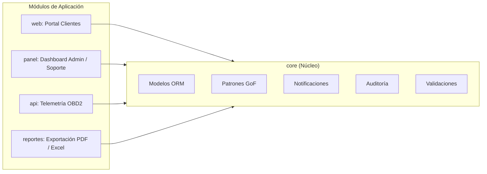
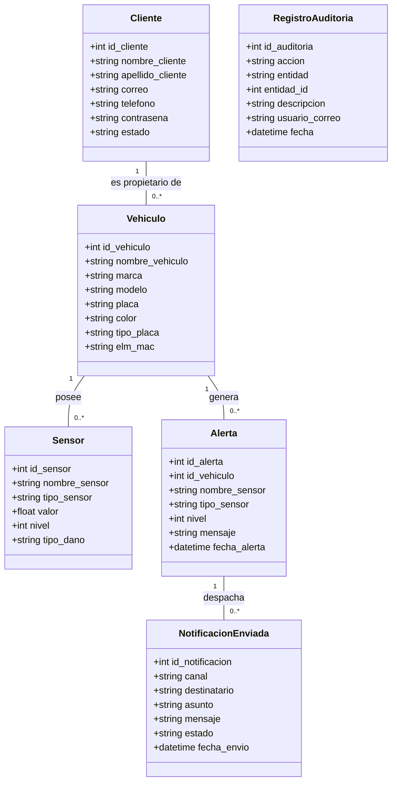
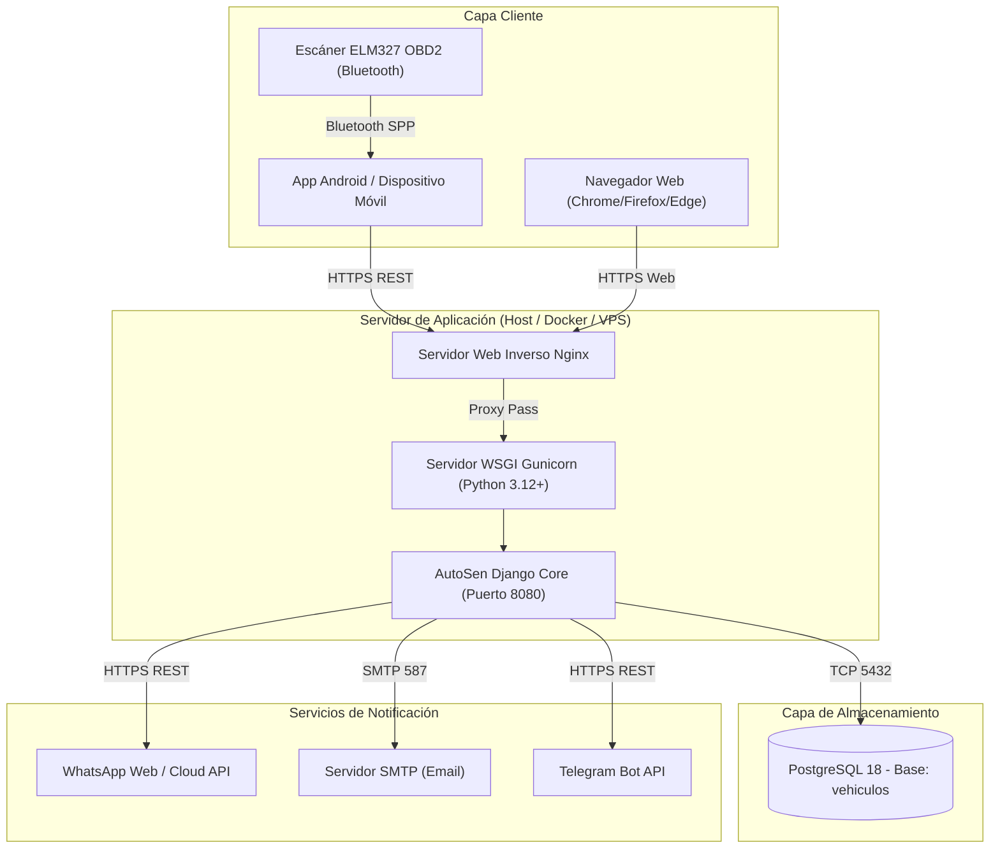

# Especificación de Arquitectura de Software — AutoSen (Django)

> **Issues asociados:**
> - `[DOC-02] Actualizar el Documento de Especificación de Arquitectura (#2)`
> - `[DOC-08] Rehacer los diagramas de clases, paquetes, componentes y despliegue (#8)`

---

## 1. Visión General de la Arquitectura

**AutoSen** es una plataforma web y de telemetría automotriz construida sobre **Python 3.12+**, **Django 6.1+** y **PostgreSQL 18**. La solución implementa una arquitectura modular por capas basada en el patrón arquitectónico **MVT (Model-View-Template)** complementada con patrones de diseño orientados a objetos **GoF (Gang of Four)**.

El sistema se compone de dos frentes principales:
1. **Portal Web Responsivo:** Para clientes, técnicos de soporte y administradores del sistema.
2. **API REST / OBD2:** Servicio JSON sin estado (stateless) para comunicación bidireccional con escáneres ELM327 Bluetooth y la aplicación cliente Android.

---

## 2. Diagrama de Paquetes y Módulos

El proyecto se estructura en 5 aplicaciones Django desacopladas bajo la raíz `autosen/`:

* **`core/`**: Modelos de base de datos (`Cliente`, `Vehiculo`, `Sensor`, `Alerta`, `RegistroAuditoria`, `NotificacionEnviada`, `Usuario`), patrones GoF, autenticación personalizada y utilidades de normalización.
* **`api/`**: Endpoints para sincronización de telemetría OBD2, lectura de códigos DTC y simulación de desgaste.
* **`panel/`**: Vistas administrativas con control de acceso por roles (`SUPERADMIN`, `ADMIN`, `SOPORTE`), calibración técnica y auditoría.
* **`web/`**: Portal del cliente para registro (con correo y WhatsApp), gestión vehicular y monitoreo personal.
* **`reportes/`**: Generador de reportes con filtros dinámicos y exportación en PDF, CSV y Excel.

---

## 3. Patrones de Diseño GoF Implementados

| Patrón GoF | Tipo | Aplicación en AutoSen | Ubicación en el Código |
| :--- | :--- | :--- | :--- |
| **Strategy (Estrategia)** | Comportamiento | Cálculo dinámico del nivel de desgaste y estado de sensores OBD2 (ECT, MAP, RPM, TPS, O2, Combustible). | `core/patrones/estrategia/` |
| **Observer (Observador)** | Comportamiento | Despacho reactivo de notificaciones multicanal (Email, WhatsApp, Telegram, Web Push) cuando se detecta una alerta crítica. | `core/patrones/observador/` y `core/notificaciones.py` |
| **Factory Method (Fábrica)** | Creacional | Creación parametrizada de sensores automotrices con umbrales, nombres y unidades predeterminadas. | `core/patrones/fabrica/` y `core/sensores_defecto.py` |
| **Singleton** | Creacional | Instancia única compartida del importador de datos y configuración del sistema. | `core/patrones/singleton/` |

---

## 4. Diagrama de Clases del Dominio Principal

---

## 5. Diagrama de Despliegue Físico

