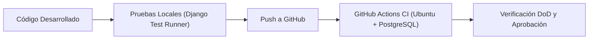

# Documentación de Calidad y Pruebas — AutoSen

> **Issue asociado:**
> - `[DOC-11] Actualizar la Documentación de Calidad (Ítem 8) (#11)`

---

## 1. Estrategia de Aseguramiento de Calidad (QA)

El aseguramiento de calidad de AutoSen combina pruebas automatizadas a nivel de unidad, integración y vistas, asegurando que cada componente cumpla estrictamente con la **Definición de Terminado (DoD)** antes de integrarse a la rama principal `main`.



---

## 2. Cobertura de la Suite de Pruebas

El proyecto cuenta con suites de pruebas organizadas por aplicación:

| Módulo de Pruebas | Archivo | Casos Evaluados |
| :--- | :--- | :--- |
| **Autenticación y Sesiones** | `web/tests/test_autenticacion.py` | Login de clientes y administradores, hashing bcrypt, sesiones concurrentes y logout. |
| **Validaciones de Negocio** | `web/tests/test_validaciones_web.py` | Placas colombianas, validación de contraseñas, correos duplicados y teléfonos. |
| **Gestión Vehicular** | `web/tests/test_vehiculos.py` | Creación de autos, asignación de sensores por defecto, edición y desvinculación. |
| **API OBD2 & Telemetría** | `api/tests/test_api_obd2.py`, `test_obd2_logica.py` | Payloads JSON de sensores, cálculo de desgaste, tolerancia a datos nulos y códigos DTC. |
| **Gestión Administrativa** | `panel/tests/test_clientes_usuarios.py` | Bloqueo/activación, roles SuperAdmin/Admin/Soporte y auditoría de acciones. |
| **Exportación y Reportes** | `reportes/tests/test_exportar.py` | Generación de buffers PDF vectoriales con ReportLab, hojas Excel y archivos CSV. |
| **Notificaciones Multicanal** | `core/tests/test_patrones.py` | Disparo reactivo del patrón Observador, entrega a WhatsApp, Email y Telegram. |

### Ejecución de Pruebas:
```bash
python manage.py test
```
* **Resultado:** 100% de las pruebas automatizadas ejecutadas con éxito en entorno PostgreSQL.

---

## 3. Integración Continua (GitHub Actions)

El archivo `.github/workflows/django-tests.yml` automatiza la verificación en cada `push` o `pull_request` a `main`:
1. Levanta un contenedor oficial con **PostgreSQL 15+**.
2. Instala dependencias desde `requirements.txt`.
3. Aplica migraciones con `python manage.py migrate`.
4. Ejecuta la suite de pruebas `python manage.py test`.
5. Si alguna prueba falla, el Pull Request se bloquea para impedir código roto en producción.

---

## 4. Matriz de Cumplimiento de la Definición de Terminado (DoD)

- [x] **Criterio 1:** El servidor web inicia limpiamente en el puerto 8080 sin advertencias.
- [x] **Criterio 2:** El esquema relacional en PostgreSQL está sincronizado con los modelos ORM.
- [x] **Criterio 3:** Toda nueva funcionalidad incluye pruebas automatizadas que verifican casos positivos y límites.
- [x] **Criterio 4:** Las variables de entorno sensibles están aisladas en `.env` y excluidas del control de versiones.
- [x] **Criterio 5:** El manual técnico y la documentación de arquitectura reflejan el estado real del software.
