# Historias de Usuario y Casos de Uso — AutoSen

> **Issues asociados:**
> - `[DOC-05] Actualizar y completar las historias de usuario (#5)`
> - `[DOC-06] Actualizar los casos de uso y sus diagramas (#6)`

---

## 1. Historias de Usuario Detalladas

### HU-01: Auto-registro con Teléfono y WhatsApp
* **Como:** Propietario de un vehículo automotor.
* **Quiero:** Registrarme en el portal ingresando mi nombre, apellido, correo, contraseña y número de teléfono/WhatsApp.
* **Para:** Crear mi cuenta y recibir alertas mecánicas directamente en mi celular.
* **Criterios de Aceptación:**
  1. Si ingreso todos los datos válidos, se crea el cliente en estado `activo` y se redirige a `/login`.
  2. Si el teléfono se deja vacío, el sistema lo acepta como opcional sin bloquear el registro.
  3. Si el correo ya existe, se muestra el mensaje *"El correo ya está registrado"* y se conservan los datos tipeados.

### HU-02: Diagnóstico Operativo para Soporte Técnico
* **Como:** Técnico de soporte o mecánico del taller.
* **Quiero:** Disponer de un dashboard en tiempo real con semáforos de advertencia y alertas sonoras.
* **Para:** Identificar de inmediato qué vehículos tienen sensores en estado de falla crítica (≥70%) y calibrarlos.
* **Criterios de Aceptación:**
  1. El técnico ingresa con rol `SOPORTE` y visualiza la cuadrícula de incidencias críticas priorizadas.
  2. Cada sensor muestra su porcentaje de desgaste, barra de progreso y botón de calibración directa.
  3. Las notificaciones Web Push emergentes alertan con sonido ante nuevas fallas detectadas.

### HU-03: Auditoría y Control para SuperAdministrador
* **Como:** SuperAdministrador de AutoSen.
* **Quiero:** Acceder a un registro inmutable de auditoría y al módulo de gestión de administradores.
* **Para:** Conocer qué usuario modificó o eliminó clientes, vehículos o sensores, y gestionar el equipo de trabajo.
* **Criterios de Aceptación:**
  1. Solo los usuarios con rol `SUPERADMIN` pueden acceder a `/admin/auditoria` y `/admin/usuario/nuevo`.
  2. Cada alta, baja o cambio de estado registra fecha, usuario, entidad y descripción de la acción.
  3. No se permite eliminar ni editar registros de auditoría para asegurar la inmutabilidad.

### HU-04: Despacho Multicanal de Alertas Críticas
* **Como:** Conductor que viaja por carretera.
* **Quiero:** Que el sistema notifique a mi WhatsApp y correo si la temperatura del motor (ECT) o la presión (MAP) superan umbrales seguros.
* **Para:** Detener el vehículo preventivamente y solicitar asistencia mecánica antes de fundir el motor.
* **Criterios de Aceptación:**
  1. Ante un nivel ≥70%, se despachan notificaciones por Email, WhatsApp, Telegram y Web Push.
  2. El mensaje de WhatsApp llega exactamente al número registrado en el perfil del cliente.
  3. La bandeja de salida multicanal (`/admin/notificaciones`) muestra el historial y permite abrir el chat de WhatsApp con un clic.

---

## 2. Diagrama General de Casos de Uso

```mermaid
graph TD
    Client["👤 Cliente / Propietario"]
    Admin["🛡️ Administrador"]
    SuperAdmin["👑 SuperAdministrador"]
    Support["🔧 Soporte Técnico"]
    OBDApp["📱 App Android / OBD2"]

    subgraph CasosDeUso ["Casos de Uso del Sistema AutoSen"]
        CU01["CU-01: Auto-registro con Teléfono"]
        CU02["CU-02: Gestionar Vehículos"]
        CU03["CU-03: Consultar Telemetría Personal"]
        CU04["CU-04: Transmitir Lecturas OBD2"]
        CU05["CU-05: Calibrar Sensores"]
        CU06["CU-06: Despachar Alertas Multicanal"]
        CU07["CU-07: Gestionar Clientes y Flota"]
        CU08["CU-08: Exportar Reportes PDF"]
        CU09["CU-09: Gestionar Usuarios / Admins"]
        CU10["CU-10: Auditar Trazabilidad"]
    end

    Client --> CU01
    Client --> CU02
    Client --> CU03

    OBDApp --> CU04
    CU04 --> CU06

    Support --> CU05
    Support --> CU03

    Admin --> CU07
    Admin --> CU08

    SuperAdmin --> CU07
    SuperAdmin --> CU08
    SuperAdmin --> CU09
    SuperAdmin --> CU10
```

