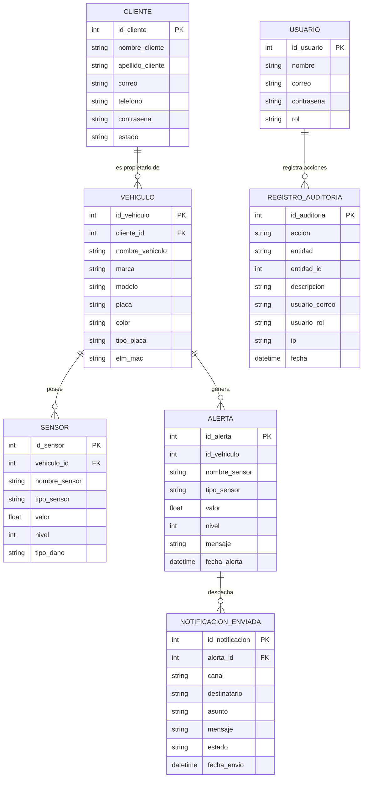

# Modelo de Datos (MER, MR y Diccionario) — AutoSen

> **Issue asociado:**
> - `[DOC-07] Actualizar el modelo de datos (MER, MR, diccionario y scripts SQL) (#7)`

---

## 1. Modelo Entidad-Relación (MER)

---

## 2. Modelo Relacional (MR)

* **`cliente`** (`id_cliente` [PK], `nombre_cliente`, `apellido_cliente`, `correo`, `telefono`, `contrasena`, `estado`)
* **`vehiculo`** (`id_vehiculo` [PK], `cliente_id` [FK -> `cliente.id_cliente`], `nombre_vehiculo`, `marca`, `modelo`, `placa`, `color`, `tipo_placa`, `elm_mac`)
* **`sensor`** (`id_sensor` [PK], `vehiculo_id` [FK -> `vehiculo.id_vehiculo`], `nombre_sensor`, `tipo_sensor`, `valor`, `nivel`, `tipo_dano`)
* **`alerta`** (`id_alerta` [PK], `id_vehiculo`, `nombre_sensor`, `tipo_sensor`, `valor`, `nivel`, `mensaje`, `fecha_alerta`)
* **`notificacion_enviada`** (`id_notificacion` [PK], `alerta_id` [FK -> `alerta.id_alerta`], `canal`, `destinatario`, `asunto`, `mensaje`, `estado`, `fecha_envio`)
* **`usuario`** (`id_usuario` [PK], `nombre`, `correo`, `contrasena`, `rol`)
* **`registro_auditoria`** (`id_auditoria` [PK], `accion`, `entidad`, `entidad_id`, `descripcion`, `usuario_correo`, `usuario_rol`, `ip`, `fecha`)

---

## 3. Diccionario de Datos

### Tabla: `cliente`
| Campo | Tipo SQL | Null | Default | Descripción |
| :--- | :--- | :---: | :---: | :--- |
| `id_cliente` | SERIAL / INT | No | AUTO | Llave primaria identificadora del cliente. |
| `nombre_cliente` | VARCHAR(50) | No | - | Nombres del cliente registrado. |
| `apellido_cliente`| VARCHAR(50) | No | - | Apellidos del cliente registrado. |
| `correo` | VARCHAR(100) | No | - | Correo electrónico único para inicio de sesión. |
| `telefono` | VARCHAR(25) | Sí | NULL | Teléfono con código de país para notificaciones WhatsApp. |
| `contrasena` | VARCHAR(255) | No | - | Hash bcrypt irreversible de la clave de acceso. |
| `estado` | VARCHAR(20) | No | 'activo'| Estado de la cuenta (`activo` o `bloqueado`). |

### Tabla: `vehiculo`
| Campo | Tipo SQL | Null | Default | Descripción |
| :--- | :--- | :---: | :---: | :--- |
| `id_vehiculo` | SERIAL / INT | No | AUTO | Llave primaria del vehículo. |
| `cliente_id` | INT | Sí | NULL | Llave foránea que referencia al propietario (`cliente`). |
| `nombre_vehiculo`| VARCHAR(50) | No | - | Alias personalizado del vehículo (ej: "Mi Mazda"). |
| `marca` | VARCHAR(50) | No | - | Marca del fabricante (Chevrolet, Mazda, Renault). |
| `modelo` | VARCHAR(50) | Sí | NULL | Año del modelo del vehículo. |
| `placa` | VARCHAR(10) | Sí | NULL | Placa normalizada del vehículo (ej: "AAA123"). |
| `color` | VARCHAR(30) | No | - | Color predominante de la carrocería. |
| `tipo_placa` | VARCHAR(20) | No | 'particular'| Tipo de servicio (`particular` o `publico`). |
| `elm_mac` | VARCHAR(50) | Sí | NULL | Dirección MAC Bluetooth del escáner OBD2 vinculado. |

### Tabla: `registro_auditoria`
| Campo | Tipo SQL | Null | Default | Descripción |
| :--- | :--- | :---: | :---: | :--- |
| `id_auditoria` | BIGSERIAL | No | AUTO | Llave primaria del registro de auditoría. |
| `accion` | VARCHAR(40) | No | - | Operación efectuada (`CREAR`, `EDITAR`, `ELIMINAR`, `BLOQUEAR`). |
| `entidad` | VARCHAR(40) | No | - | Tipo de recurso (`CLIENTE`, `VEHICULO`, `SENSOR`, `USUARIO`). |
| `entidad_id` | INT | No | - | ID numérico del recurso afectado. |
| `descripcion` | TEXT | No | - | Detalle descriptivo de los campos modificados. |
| `usuario_correo` | VARCHAR(120) | No | - | Correo del usuario que ejecutó la operación. |
| `fecha` | TIMESTAMP | No | NOW() | Fecha y hora exacta de la operación. |
