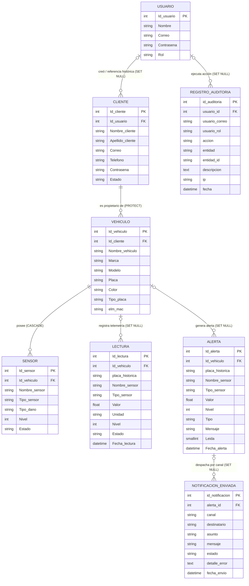

# Modelo de Datos (MER, MR, Diccionario y SQL) — AutoSen

> **Issue asociado:**
> - `[DOC-07] Actualizar el modelo de datos (MER, MR, diccionario y scripts SQL) (#7)`

---

## 1. Modelo Entidad-Relación (MER)

El siguiente diagrama representa las **8 tablas reales en PostgreSQL 18** y sus llaves foráneas efectivas en el motor de base de datos:



### Justificación de `ON DELETE SET NULL` y `placa_historica`
En un sistema de telemetría automotriz y auditoría de seguridad, **el historial operativo y la bitácora de acciones nunca deben destruirse** cuando se da de baja un vehículo o un usuario administrador:
* **`lecturas` y `alertas` → `vehiculo` (`ON DELETE SET NULL`):** garantiza integridad referencial mientras el vehículo existe y, al eliminarlo, pone `"Id_vehiculo" = NULL` sin borrar sus mediciones ni alertas históricas. El campo `placa_historica` conserva la placa que tenía el vehículo al momento del evento para mantener trazabilidad en reportes y tableros.
* **`notificaciones_enviadas` → `alertas` (`ON DELETE SET NULL`):** preserva la evidencia de envíos hacia APIs externas (Telegram, Gmail SMTP, WhatsApp Cloud API y Navegador).
* **`registro_auditoria` → `usuario` (`ON DELETE SET NULL`):** enlaza cada acción administrativa con la entidad `Usuario` activa (permitiendo consultar su nombre actual y filtrar por administrador), mientras conserva `usuario_correo` y `usuario_rol` como instantánea inmutable incluso si el administrador cambia de rol o es eliminado, o cuando ocurre un `LOGIN_FALLIDO` de un correo no registrado (`usuario_id = NULL`).

---

## 2. Modelo Relacional (MR)

* **`usuario`** (`"Id_usuario"` [PK], `"Nombre"`, `"Correo"`, `"Contrasena"`, `"Rol"`)
* **`cliente`** (`"Id_cliente"` [PK], `"Id_usuario"` [FK → `usuario."Id_usuario"` ON DELETE SET NULL, NULL], `"Nombre_cliente"`, `"Apellido_cliente"`, `"Correo"`, `"Telefono"`, `"Contrasena"`, `"Estado"`)
* **`vehiculo`** (`"Id_vehiculo"` [PK], `"Id_cliente"` [FK → `cliente."Id_cliente"` ON DELETE PROTECT], `"Nombre_vehiculo"`, `"Color"`, `"Marca"`, `"Modelo"`, `"Placa"`, `"Tipo_placa"`, `elm_mac`)
* **`sensores`** (`"Id_sensor"` [PK], `"Id_vehiculo"` [FK → `vehiculo."Id_vehiculo"` ON DELETE CASCADE, NULL], `"Nombre_sensor"`, `"Tipo_sensor"`, `"Tipo_daño"`, `"Nivel"`, `"Estado"`)
* **`lecturas`** (`"Id_lectura"` [PK], `"Id_vehiculo"` [FK → `vehiculo."Id_vehiculo"` ON DELETE SET NULL, NULL], `placa_historica`, `"Nombre_sensor"`, `"Tipo_sensor"`, `"Valor"`, `"Unidad"`, `"Nivel"`, `"Estado"`, `"Fecha_lectura"`)
* **`alertas`** (`"Id_alerta"` [PK], `"Id_vehiculo"` [FK → `vehiculo."Id_vehiculo"` ON DELETE SET NULL, NULL], `placa_historica`, `"Nombre_sensor"`, `"Tipo_sensor"`, `"Valor"`, `"Nivel"`, `"Tipo"`, `"Mensaje"`, `"Leida"`, `"Fecha_alerta"`)
* **`notificaciones_enviadas`** (`id_notificacion` [PK], `alerta_id` [FK → `alertas."Id_alerta"` ON DELETE SET NULL, NULL], `canal`, `destinatario`, `asunto`, `mensaje`, `estado`, `detalle_error`, `fecha_envio`)
* **`registro_auditoria`** (`id_auditoria` [PK], `usuario_id` [FK → `usuario."Id_usuario"` ON DELETE SET NULL, NULL], `usuario_correo`, `usuario_rol`, `accion`, `entidad`, `entidad_id`, `descripcion`, `ip`, `fecha`)

---

## 3. Diccionario de Datos

### 3.1 Tabla: `usuario`
| Columna | Tipo SQL | Null | Default | Restricción / Descripción |
| :--- | :--- | :---: | :---: | :--- |
| `"Id_usuario"` | `SERIAL / INTEGER` | No | AUTO | **PK.** Identificador del administrador. |
| `"Nombre"` | `VARCHAR(50)` | No | - | Nombre completo del administrador o técnico. |
| `"Correo"` | `VARCHAR(100)` | No | - | Correo electrónico de acceso al panel `/admin`. |
| `"Contrasena"` | `VARCHAR(100)` | No | - | Hash `bcrypt` (`$2a$10$...`). |
| `"Rol"` | `VARCHAR(20)` | No | - | Rol asignado (`SUPERADMIN`, `ADMIN`, `SOPORTE`). |

### 3.2 Tabla: `cliente`
| Columna | Tipo SQL | Null | Default | Restricción / Descripción |
| :--- | :--- | :---: | :---: | :--- |
| `"Id_cliente"` | `SERIAL / INTEGER` | No | AUTO | **PK.** Identificador único del cliente. |
| `"Id_usuario"` | `INTEGER` | Sí | `NULL` | **FK** → `usuario("Id_usuario")` (`ON DELETE SET NULL`). Referencia histórica de importación. |
| `"Nombre_cliente"` | `VARCHAR(60)` | No | - | Nombres del propietario. |
| `"Apellido_cliente"` | `VARCHAR(60)` | No | - | Apellidos del propietario. |
| `"Correo"` | `VARCHAR(70)` | No | - | Correo electrónico para login y alertas SMTP. |
| `"Telefono"` | `VARCHAR(25)` | Sí | `NULL` | Número telefónico para alertas por WhatsApp Cloud API. |
| `"Contrasena"` | `VARCHAR(100)` | No | - | Hash `bcrypt` irreversible. |
| `"Estado"` | `VARCHAR(10)` | Sí | `'activo'` | Estado de acceso (`activo` o `bloqueado`). |

### 3.3 Tabla: `vehiculo`
| Columna | Tipo SQL | Null | Default | Restricción / Descripción |
| :--- | :--- | :---: | :---: | :--- |
| `"Id_vehiculo"` | `SERIAL / INTEGER` | No | AUTO | **PK.** Identificador del vehículo. |
| `"Id_cliente"` | `INTEGER` | No | - | **FK** → `cliente("Id_cliente")` (`ON DELETE PROTECT`). Propietario del vehículo. |
| `"Nombre_vehiculo"` | `VARCHAR(60)` | No | - | Alias o línea del vehículo (ej. `Onix`). |
| `"Color"` | `VARCHAR(25)` | No | - | Color de carrocería. |
| `"Marca"` | `VARCHAR(50)` | No | - | Marca del fabricante. |
| `"Modelo"` | `VARCHAR(20)` | Sí | `NULL` | Año normalizado como `AAAA-01-01`. |
| `"Placa"` | `VARCHAR(10)` | Sí | `NULL` | Placa normalizada sin guion (ej. `ABC123`). |
| `"Tipo_placa"` | `VARCHAR(60)` | No | - | `particular`, `publico`, `oficial` o `diplomatico`. |
| `elm_mac` | `VARCHAR(50)` | Sí | `NULL` | Dirección MAC del escáner Bluetooth ELM327. |

### 3.4 Tabla: `sensores`
| Columna | Tipo SQL | Null | Default | Restricción / Descripción |
| :--- | :--- | :---: | :---: | :--- |
| `"Id_sensor"` | `SERIAL / INTEGER` | No | AUTO | **PK.** Identificador del sensor. |
| `"Id_vehiculo"` | `INTEGER` | Sí | `NULL` | **FK** → `vehiculo("Id_vehiculo")` (`ON DELETE CASCADE`). Se elimina junto con el vehículo. |
| `"Nombre_sensor"` | `VARCHAR(200)` | No | - | Nombre descriptivo del sensor. |
| `"Tipo_sensor"` | `VARCHAR(50)` | No | - | Código de magnitud (`RPM`, `ECT`, `MAF`, `O2`, `MAP`, `TEMP`, `OIL`, `FUEL`). |
| `"Tipo_daño"` | `VARCHAR(90)` | Sí | `NULL` | Descripción opcional de posible avería. |
| `"Nivel"` | `INTEGER` | No | `0` | Nivel de desgaste porcentual (`0`–`100`). |
| `"Estado"` | `VARCHAR(20)` | Sí | `NULL` | `OK`, `ADVERTENCIA` o `FALLA`. |

### 3.5 Tabla: `lecturas`
| Columna | Tipo SQL | Null | Default | Restricción / Descripción |
| :--- | :--- | :---: | :---: | :--- |
| `"Id_lectura"` | `SERIAL / INTEGER` | No | AUTO | **PK.** Identificador de la lectura OBD2. |
| `"Id_vehiculo"` | `INTEGER` | Sí | `NULL` | **FK** → `vehiculo("Id_vehiculo")` (`ON DELETE SET NULL`). Conserva la lectura si se borra el vehículo. |
| `placa_historica` | `VARCHAR(10)` | Sí | `NULL` | Placa del vehículo capturada al momento de registrar la lectura. |
| `"Nombre_sensor"` | `VARCHAR(120)` | No | - | Nombre del sensor medido. |
| `"Tipo_sensor"` | `VARCHAR(50)` | No | - | Tipo de sensor medido. |
| `"Valor"` | `DOUBLE PRECISION` | No | - | Valor numérico reportado por el escáner. |
| `"Unidad"` | `VARCHAR(20)` | No | `''` | Unidad física (`rpm`, `°C`, `g/s`, `V`, `%`). |
| `"Nivel"` | `INTEGER` | No | `0` | Nivel calculado (`0`–`100`). |
| `"Estado"` | `VARCHAR(20)` | No | `'OK'` | `OK`, `ADVERTENCIA` o `FALLA`. |
| `"Fecha_lectura"` | `TIMESTAMP` | No | - | Fecha y hora de recepción de la trama. |

### 3.6 Tabla: `alertas`
| Columna | Tipo SQL | Null | Default | Restricción / Descripción |
| :--- | :--- | :---: | :---: | :--- |
| `"Id_alerta"` | `SERIAL / INTEGER` | No | AUTO | **PK.** Identificador de la alerta. |
| `"Id_vehiculo"` | `INTEGER` | Sí | `NULL` | **FK** → `vehiculo("Id_vehiculo")` (`ON DELETE SET NULL`). Conserva la alerta si se borra el vehículo. |
| `placa_historica` | `VARCHAR(10)` | Sí | `NULL` | Placa del vehículo capturada al momento de generar la alerta. |
| `"Nombre_sensor"` | `VARCHAR(120)` | No | - | Sensor que originó la alerta. |
| `"Tipo_sensor"` | `VARCHAR(50)` | No | - | Tipo de sensor. |
| `"Valor"` | `DOUBLE PRECISION` | No | - | Valor medido al dispararse la alerta. |
| `"Nivel"` | `INTEGER` | No | - | Nivel de desgaste (`>= 40`). |
| `"Tipo"` | `VARCHAR(20)` | No | - | `advertencia` (`40–69`) o `falla` (`>= 70`). |
| `"Mensaje"` | `VARCHAR(255)` | No | - | Diagnóstico legible generado. |
| `"Leida"` | `SMALLINT` | Sí | `0` | `0` no leída, `1` leída. |
| `"Fecha_alerta"` | `TIMESTAMP` | No | - | Fecha y hora de generación. |

### 3.7 Tabla: `notificaciones_enviadas`
| Columna | Tipo SQL | Null | Default | Restricción / Descripción |
| :--- | :--- | :---: | :---: | :--- |
| `id_notificacion` | `SERIAL / INTEGER` | No | AUTO | **PK.** Identificador del despacho. |
| `alerta_id` | `INTEGER` | Sí | `NULL` | **FK** → `alertas("Id_alerta")` (`ON DELETE SET NULL`). |
| `canal` | `VARCHAR(20)` | No | - | `TELEGRAM`, `EMAIL`, `WHATSAPP` o `NAVEGADOR`. |
| `destinatario` | `VARCHAR(100)` | No | - | Chat ID, correo electrónico o teléfono internacional. |
| `asunto` | `VARCHAR(150)` | No | - | Encabezado o resumen de la notificación. |
| `mensaje` | `TEXT` | No | - | Contenido despachado. |
| `estado` | `VARCHAR(20)` | No | `'ENVIADO'` | `ENVIADO`, `FALLIDO`, `OMITIDO` o `EN_COLA`. |
| `detalle_error` | `TEXT` | Sí | `NULL` | Motivo del fallo u omisión (sin exponer secretos). |
| `fecha_envio` | `TIMESTAMP` | No | `NOW()` | Marca de tiempo del intento de envío. |

### 3.8 Tabla: `registro_auditoria`
| Columna | Tipo SQL | Null | Default | Restricción / Descripción |
| :--- | :--- | :---: | :---: | :--- |
| `id_auditoria` | `SERIAL / INTEGER` | No | AUTO | **PK.** Identificador inmutable del evento. |
| `usuario_id` | `INTEGER` | Sí | `NULL` | **FK** → `usuario("Id_usuario")` (`ON DELETE SET NULL`). Administrador autor de la acción (`NULL` si fue eliminado o en `LOGIN_FALLIDO` de correo inexistente). |
| `usuario_correo` | `VARCHAR(100)` | No | - | Instantánea del correo al momento de la acción (o correo intentado en `LOGIN_FALLIDO`). |
| `usuario_rol` | `VARCHAR(30)` | No | - | Instantánea del rol (`SUPERADMIN`, `ADMIN`, `SOPORTE` o `NO_REGISTRADO`). |
| `accion` | `VARCHAR(30)` | No | - | `CREAR`, `EDITAR`, `ELIMINAR`, `CALIBRAR`, `BLOQUEAR`, `ACTIVAR`, `LOGIN`, `LOGIN_FALLIDO`, `LOGOUT`, `TEST`, `REINTENTAR`. |
| `entidad` | `VARCHAR(30)` | No | - | `CLIENTE`, `VEHICULO`, `SENSOR`, `USUARIO`, `SISTEMA`, `SESION`, `ALERTA`, `NOTIFICACION`. |
| `entidad_id` | `VARCHAR(50)` | Sí | `NULL` | Identificador del recurso afectado. |
| `descripcion` | `TEXT` | No | - | Detalle legible (jamás almacena contraseñas). |
| `ip` | `VARCHAR(45)` | No | `'127.0.0.1'` | Dirección IP del cliente (`X-Forwarded-For` o `REMOTE_ADDR`). |
| `fecha` | `TIMESTAMP` | No | `NOW()` | Fecha y hora exacta del evento. |

---

## 4. Script SQL DDL de Referencia (PostgreSQL 18)

```sql
CREATE TABLE "usuario" (
    "Id_usuario" SERIAL PRIMARY KEY,
    "Nombre" VARCHAR(50) NOT NULL,
    "Correo" VARCHAR(100) NOT NULL,
    "Contrasena" VARCHAR(100) NOT NULL,
    "Rol" VARCHAR(20) NOT NULL
);

CREATE TABLE "cliente" (
    "Id_cliente" SERIAL PRIMARY KEY,
    "Nombre_cliente" VARCHAR(60) NOT NULL,
    "Apellido_cliente" VARCHAR(60) NOT NULL,
    "Contrasena" VARCHAR(100) NOT NULL,
    "Correo" VARCHAR(70) NOT NULL,
    "Estado" VARCHAR(10) DEFAULT 'activo',
    "Telefono" VARCHAR(25) NULL,
    "Id_usuario" INTEGER NULL REFERENCES "usuario" ("Id_usuario") ON DELETE SET NULL DEFERRABLE INITIALLY DEFERRED
);

CREATE TABLE "vehiculo" (
    "Id_vehiculo" SERIAL PRIMARY KEY,
    "Id_cliente" INTEGER NOT NULL REFERENCES "cliente" ("Id_cliente") ON DELETE RESTRICT DEFERRABLE INITIALLY DEFERRED,
    "Nombre_vehiculo" VARCHAR(60) NOT NULL,
    "Color" VARCHAR(25) NOT NULL,
    "Marca" VARCHAR(50) NOT NULL,
    "Modelo" VARCHAR(20) NULL,
    "Placa" VARCHAR(10) NULL,
    "Tipo_placa" VARCHAR(60) NOT NULL,
    "elm_mac" VARCHAR(50) NULL
);

CREATE TABLE "sensores" (
    "Id_sensor" SERIAL PRIMARY KEY,
    "Nombre_sensor" VARCHAR(200) NOT NULL,
    "Tipo_sensor" VARCHAR(50) NOT NULL,
    "Tipo_daño" VARCHAR(90) NULL,
    "Nivel" INTEGER NOT NULL DEFAULT 0,
    "Estado" VARCHAR(20) NULL,
    "Id_vehiculo" INTEGER NULL REFERENCES "vehiculo" ("Id_vehiculo") ON DELETE CASCADE DEFERRABLE INITIALLY DEFERRED
);

CREATE TABLE "lecturas" (
    "Id_lectura" SERIAL PRIMARY KEY,
    "Id_vehiculo" INTEGER NULL REFERENCES "vehiculo" ("Id_vehiculo") ON DELETE SET NULL DEFERRABLE INITIALLY DEFERRED,
    "placa_historica" VARCHAR(10) NULL,
    "Nombre_sensor" VARCHAR(120) NOT NULL,
    "Tipo_sensor" VARCHAR(50) NOT NULL,
    "Valor" DOUBLE PRECISION NOT NULL,
    "Unidad" VARCHAR(20) NOT NULL DEFAULT '',
    "Nivel" INTEGER NOT NULL DEFAULT 0,
    "Estado" VARCHAR(20) NOT NULL DEFAULT 'OK',
    "Fecha_lectura" TIMESTAMP NOT NULL
);

CREATE TABLE "alertas" (
    "Id_alerta" SERIAL PRIMARY KEY,
    "Id_vehiculo" INTEGER NULL REFERENCES "vehiculo" ("Id_vehiculo") ON DELETE SET NULL DEFERRABLE INITIALLY DEFERRED,
    "placa_historica" VARCHAR(10) NULL,
    "Nombre_sensor" VARCHAR(120) NOT NULL,
    "Tipo_sensor" VARCHAR(50) NOT NULL,
    "Valor" DOUBLE PRECISION NOT NULL,
    "Nivel" INTEGER NOT NULL,
    "Tipo" VARCHAR(20) NOT NULL,
    "Mensaje" VARCHAR(255) NOT NULL,
    "Leida" SMALLINT NULL DEFAULT 0,
    "Fecha_alerta" TIMESTAMP NOT NULL
);

CREATE TABLE "notificaciones_enviadas" (
    "id_notificacion" SERIAL PRIMARY KEY,
    "alerta_id" INTEGER NULL REFERENCES "alertas" ("Id_alerta") ON DELETE SET NULL DEFERRABLE INITIALLY DEFERRED,
    "canal" VARCHAR(20) NOT NULL,
    "destinatario" VARCHAR(100) NOT NULL,
    "asunto" VARCHAR(150) NOT NULL,
    "mensaje" TEXT NOT NULL,
    "estado" VARCHAR(20) NOT NULL DEFAULT 'ENVIADO',
    "detalle_error" TEXT NULL,
    "fecha_envio" TIMESTAMP NOT NULL DEFAULT NOW()
);

CREATE TABLE "registro_auditoria" (
    "id_auditoria" SERIAL PRIMARY KEY,
    "usuario_id" INTEGER NULL REFERENCES "usuario" ("Id_usuario") ON DELETE SET NULL DEFERRABLE INITIALLY DEFERRED,
    "usuario_correo" VARCHAR(100) NOT NULL,
    "usuario_rol" VARCHAR(30) NOT NULL,
    "accion" VARCHAR(30) NOT NULL,
    "entidad" VARCHAR(30) NOT NULL,
    "entidad_id" VARCHAR(50) NULL,
    "descripcion" TEXT NOT NULL,
    "ip" VARCHAR(45) NOT NULL DEFAULT '127.0.0.1',
    "fecha" TIMESTAMP NOT NULL DEFAULT NOW()
);
```
